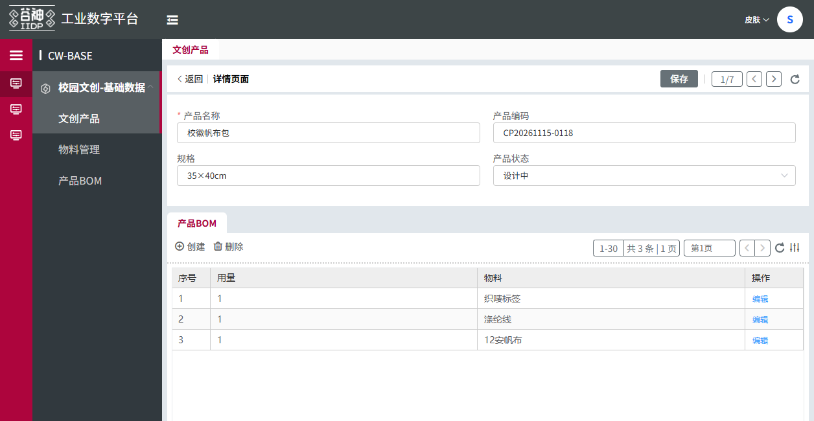
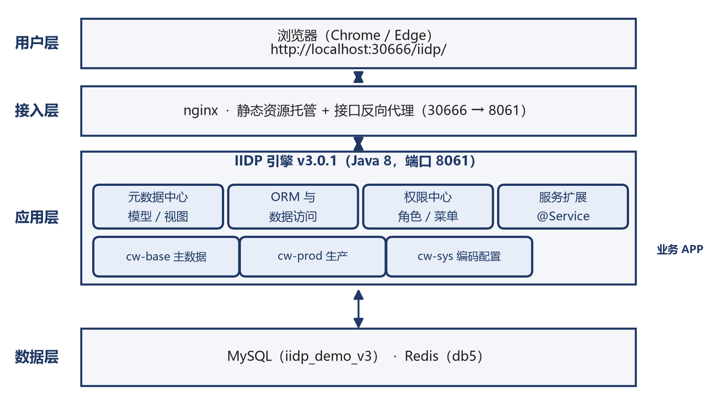

# 校园文创产品生产管理系统

> 《中级软件设计实作》课程项目 · 课题一 MES 管理系统 · 基于赛意 IIDP 模型驱动低代码平台的三个业务 APP

课程实作项目：三个 Maven APP 模块、六张业务表、九个自定义服务，配 56 页开发文档。当前状态是"接口层跑通、界面基本可用"，还没做完的部分写在文末的「已知限制」里。


## 这是什么

学校文创工作室用 Excel 加微信群排产：产品编码靠人编、BOM 靠记忆、工单靠聊天记录。这个项目把"MES 的产品—BOM—物料—工单"这条主线搬进校园文创场景，用 IIDP 平台把它做成三个可独立部署的 APP。

| | |
| --- | --- |
| 业务场景 | 校徽帆布包、金属校徽、校园明信片、纪念马克杯等文创产品的打样与批量制作 |
| 系统边界 | 只管"东西怎么做出来"：主数据、BOM、编码、工单。不含商城、支付、物流、评价、采购、库存台账 |
| 角色 | 文创设计员、生产主管、仓库管理员、系统管理员 |
| 规模 | 3 个 APP、6 个模型、9 个自定义服务、11 个视图、9 个菜单 |

## 界面

表单页与 BOM 标签页——主子表在同一页维护，标签题上直接带明细条数：



编码规则页——三条规则（WO/MT/CP）同表维护，改完立即对后续取号生效：


## 课题九条要求怎么落的

| 课题要求 | 本项目实现 |
| --- | --- |
| 产品管理（名称、规格） | `cw_product` + 产品列表/表单视图 |
| 物料管理（编码唯一） | `cw_material`，编码由编码服务生成并加唯一约束 |
| 产品 BOM 标签页 + 数量 | 产品表单内 `产品BOM` 标签页，`cw_product_bom.amount` 存用量 |
| BOM 添加、删除 | 子表内增删行，随主表一次保存 |
| 编码规则增删改查 | `cw_code_rule` + 编码规则页面（前缀、日期格式、流水位数、分隔符、启用） |
| 按规则生成编码 | `codeRuleService.generate`，四段式 `CP20261115-0118` |
| 业务模型使用该服务 | 产品、物料、工单三类编码统一走同一套取号 |
| 身边的例子 | 校园文创工作室（本校真实场景） |
| 按模块拆分 APP | `cw-base` / `cw-prod` / `cw-sys` 三个 jar |

## 架构



- **cw-base**：产品、物料、产品 BOM（主数据）
- **cw-prod**：生产工单（跨 APP 用 `@ManyToOne(targetModel = "product")` 弱引用产品，不直接 import 对方类）
- **cw-sys**：编码规则、编码流水、编码生成服务

三个 APP 独立打包，但跑在同一个引擎进程里——两周工期不引入注册中心与网关，边界用包和 jar 表达。

## 技术栈

| 层 | 选型 |
| --- | --- |
| 后端 | Java 8、Spring Boot 2.7.13（引擎底座）、IIDP 引擎 v3.0.1-HOTFIX.002、SDK v3.0.1-UAT.003 |
| 构建 | Maven 3.9.1（离线构建，本地仓库 `D:\maven\repository`） |
| 数据库 | MySQL 8（库 `iidp_demo_v3`，字符集 utf8mb4 / utf8mb4_bin，六张业务表由模型注解自动建） |
| 缓存 | Redis（db5） |
| 前端 | 平台预编译 dist + nginx（30666），页面由视图 JSON 动态渲染，前端零代码 |
| 对象存储 | MinIO（19000，平台附件用） |
| 文档 | python-docx 生成 docx、matplotlib 画图 |

## 仓库结构

```
.
├── start-all.ps1 / stop-all.ps1                      # 一键启动 / 停止（Windows）
├── README.md
├── iidp-backend-demo/                                # 完整后端工程（含课程参考程序）
│   ├── pom.xml / settings.xml                        # 聚合 pom、镜像与本地仓库配置
│   ├── apps/
│   │   ├── apps.json                                 # 装载清单（官方 11 个 + cw 三个）
│   │   └── modules/README.md                         # 需要放哪些 jar（jar 本身不入库）
│   ├── sql/                                          # 平台初始化脚本
│   ├── sie-iidp-demo-apps/                           # 自研 APP 模块
│   │   ├── sie-snest-cw-base/   product / material / product_bom
│   │   ├── sie-snest-cw-prod/   work_order
│   │   ├── sie-snest-cw-sys/    code_rule / code_seq + 编码服务
│   │   └── sie-snest-mes/       （课程参考示例，未改动）
│   ├── sie-iidp-demo-common/
│   └── sie-iidp-demo-start/                          # 引擎启动模块与配置
└── images/                   # README 里用到的 4 张图（其余插图见开发文档）
```

## 环境准备

必装：JDK 1.8、Maven 3.9.1、MySQL 8、Redis、nginx。

课程会提供三样东西，**不在本仓库里**（属于课程环境，体积大或为二进制）：

1. **11 个平台官方 jar**：放到 `iidp-backend-demo/apps/modules/`，清单见该目录的 `README.md`
2. **预编译前端 dist**（含 nginx 配置与 `html/`）：课程发的 `release/` 目录
3. **授权服务 `grant-dev.exe`**：放到 `sie-grant/`

本机目录约定（换机器改脚本顶部与 `dbcp.properties` 即可）：

| 用途 | 路径 |
| --- | --- |
| JDK | `D:\Java\JDK1.8` |
| Maven | `E:\maven\apache-maven-3.9.1` |
| 本地仓库 | `D:\maven\repository` |
| Redis | `E:\redis\redis-server.exe` |
| nginx | `.runtime\nginx-windows\nginx-1.30.6-windows` |
| 授权服务 | `sie-grant\grant-dev.exe` |

## 一键启动

```powershell
Set-ExecutionPolicy -Scope CurrentUser RemoteSigned   # 只需一次
.\start-all.ps1            # 启动 MySQL -> Redis -> grant -> 引擎 -> nginx
.\start-all.ps1 -Build     # 先 mvn package 再启动
.\stop-all.ps1             # 停引擎 / nginx / 授权服务（Redis 与 MySQL 保留）
```

脚本会逐项检查端口、跳过已在运行的进程，最后打印端口状态与登录地址；日志写在 `.runtime\logs\`。

启动完成后打开 **http://localhost:30666/iidp/**，账号 `admin_000001 / Admin_000001`（平台租户管理员是 `implementer / Implementer_2023`）。

### 手动启动（课程里的顺序）

| 步 | 启动 | 端口 |
| --- | --- | --- |
| 0 | MySQL（Windows 服务，库 `iidp_demo_v3`，utf8mb4 / utf8mb4_bin） | 3306 |
| 1 | `E:\redis\redis-server.exe` | 6379 |
| 2 | `sie-grant\grant-dev.exe`（建议用 CMD 起） | 8080 |
| 3 | 引擎 `DemoServer`（IDE 跑要选对工作目录，见下） | 8061 |
| 4 | nginx（`html/dist` 指向课程前端 dist） | 30666 |

引擎两种起法：

```powershell
# a) jar 方式（工作目录必须是 iidp-backend-demo）
cd iidp-backend-demo
java -jar sie-iidp-demo-start\target\sie-iidp-demo-start-1.0-SNAPSHOT.jar

# b) IDE 方式：运行 com.sie.iidp.demo.service.DemoServer 的 main
#    Run → Edit Configurations → Working directory 设为 ...\iidp-demo-3.0\iidp-backend-demo
#    VM options 加 -Dfile.encoding=UTF-8
```

引擎按相对路径读 `apps/apps.json` 与 `apps/modules/*.jar`，工作目录填错就会报"元模型[null]在引擎容器中不存在"。

### 两个"改了没生效"的注意点

1. **改 `application-dev.properties` 必须重新打包**，否则运行的还是打进 jar 里的旧配置：
   ```powershell
   $env:JAVA_HOME='D:\Java\JDK1.8'
   $env:MAVEN_ARGS='-Dmaven.repo.local=D:\maven\repository'
   mvn -s settings.xml -o -DskipTests -pl sie-iidp-demo-start -am package
   ```
2. **重启前先停 java 进程**，否则构建时 `apps\modules\*.jar` 被占用，报"另一个程序正在使用此文件"。

## 把工程同步给组员

仓库里只有代码、脚本、文档成品和 4 张 README 插图；三样课程环境的东西（11 个官方 jar、前端 dist、`grant-dev.exe`）体积大或不能公开分发，需要单独给。

**第一步，组员克隆仓库**（把 `<url>` 换成仓库地址）：

```powershell
git clone <url> campus-cw
cd campus-cw
```

**第二步，补三个外部件**（从课程资料或你手里拷）：

| 放到哪 | 放什么 |
| --- | --- |
| `iidp-backend-demo\apps\modules\` | 课程提供的 11 个官方 jar（文件名清单见该目录的 `README.md`） |
| `release\iidp-frontend-dist-20261028\` | 课程发的前端 dist（nginx 配置里指向它） |
| `sie-grant\` | `grant-dev.exe` |

**第三步，建库**：MySQL 里建 `iidp_demo_v3`，字符集 `utf8mb4`、排序规则 `utf8mb4_bin`；如果拿到的是你导出的库，直接 `mysql --default-character-set=utf8mb4 -u root -p iidp_demo_v3 < dump.sql` 导入，再执行一次 `iidp-backend-demo\sql\platform-web-app-init.sql`。

**第四步，改本机路径**：`start-all.ps1` 顶部的 `$JavaHome`、`$MavenHome`、`$MavenRepo`、`$RedisExe`、`$NginxHome` 五个变量，以及 `iidp-backend-demo\sie-iidp-demo-start\src\main\resources\dbcp.properties` 里的数据库地址与密码。

**第五步，跑起来**：

```powershell
.\start-all.ps1 -Build
```

看到 `Started DemoServer` 且 30666/8061 都通，就算同步成功。首次登录用 `admin_000001 / Admin_000001`；如果左侧菜单是空的，按下面第 1 个坑补 `rbac_role_auth`。

**如果你要用 GitHub 协作**：在仓库 Settings → Collaborators 里把组员的 GitHub 账号加进来（write 权限），他就能直接 `git push`；不想给写权限就让他 fork 后提 Pull Request。代码改动集中在 `sie-iidp-demo-apps/sie-snest-cw-*/`，两个人分开改不同 APP 时冲突很少；改同一个文件前先说一声，pull 一下再动手。

**如果组员环境跑不起来**，最快的对齐方式是把你本机的 `iidp_demo_v3` 导出成 SQL 一起发过去——菜单、授权、编码规则、测试数据全在里面，比让他照着文档一步步配快得多。

## 三个必须知道的坑

### 1. 菜单不显示：缺应用级授权

除了 `tenant_meta_mapping` 里的菜单映射，自研 APP 还需要 `rbac_role_auth` 的**应用级授权**（平台 UI 的"租户授权"会写，手工部署容易漏）。缺这几行时 `ui_menu.loadMenu` 返回空数组，登录后左侧菜单是空的。

```sql
INSERT INTO rbac_role_auth (id, version, app_all, app_tag, role, app_name, tenant_id, create_user, create_date)
SELECT REPLACE(UUID(),'-',''), 0, '1', 'master', 'rbac_role_admin', 'cw-base', 'rbac_tenant_root', 'admin', NOW();
-- 同理补 cw-prod、cw-sys，以及目标角色
```

排查全过程写在文档 6.9.2。

### 2. 启动即崩：`apps/modules` 里有重复版本 jar

`SingleAppLoader.listLocalAppsByJson()` 解析出 `null` 元素，引擎在 `AppProcessor.toMap()` 抛 NPE。把同一 APP 的 `-RELEASE` 与 `-UAT` 并存、或示例工程的 mes jar 混在里面就会触发。清理成"11 个官方 + 3 个自研"。

### 3. `app.json` 的 `product` 字段不能重复

它决定左侧入口（产品线）。两个 APP 用同一个 `product` 会导致其中一个不显示入口。本项目用 `CW-BASE` / `CW-PROD` / `CW-SYS`。

## 关键实现

**并发安全的编码服务**。参考程序的 `CodeGenerator` 用静态计数器，进程重启即归零、多实例必然重号。改成"规则表 + 流水表 + 行锁 + 条件自增 + 唯一索引"：

```sql
SELECT curr_value FROM cw_code_seq WHERE rule_code = ? AND date_seg = ? FOR UPDATE;
UPDATE cw_code_seq SET curr_value = curr_value + 1 WHERE id = ? AND curr_value = ?;
```

20 线程并发取号 20/20 唯一、号码连续，`preview` 只读不占号。

**跨 APP 引用**。两个 APP 由不同类加载器加载，直接 `import` 对方模型运行期会 `NoClassDefFoundError`，改用 `@ManyToOne(targetModel = "product")` 让引擎按模型名在全局元数据里解析。

**BOM 主子表**。`@OneToMany` + 视图 JSON 的 `tabs` 配置，产品表单里直接出子表标签页，增删行随主表一次提交。

**界面新增也走编码服务**。平台自带的 `create` 服务在这个版本不可用，界面上的「新增」会绕过自研的取号逻辑，于是三个模型各自重写了 `create(List<Map>)`：先按规则补 `code`，再 `getMeta().get("product").callSuper(Product.class, "create", valuesList)` 交回平台落库。同时给三张表的 `code` 加了唯一索引，界面留空编码也能生成 `CP20261115-0145` 这样的号。

**工单状态按钮**。工单列表的操作列有「下达」「报完工」，服务里按 `status` 白名单校验（1→2→3、2→1 可回退），已完工再点下达会被拒绝并提示原因。

## 踩过的坑（都写进文档了）

| 坑 | 真相 |
| --- | --- |
| 引擎启动 NPE | `apps/modules` 混入重复版本的 UAT jar 与示例 jar，解析出的 APP 列表含 null 元素 |
| 菜单空白 | 缺 `rbac_role_auth` 应用级授权，不是菜单表的问题 |
| 服务调不到 | SDK 只扫描 `@Model` 类上的 `@MethodService`，独立 `@Service` 类不生效 |
| 查询恒空 | `search(filter, properties, ...)` 的 `properties` 传 null 时引擎拼不出 SELECT 列 |
| 关联字段过滤不到 | `Filter` 对 `@ManyToOne` 字段恒为空，改原生 SQL；写入关联字段要传主键字符串 |
| 平台 `create` 服务 500 | 该版本 `BussModelDataAccess.create` 取不到记录列表，改用自研服务 |

## 文档

开发文档（`校园文创产品生产管理系统-项目开发文档.docx` / `.pdf`，56 页 10 章：需求、可行性、概要设计、详细设计、实现、分工、学习与中期检查、过程管理、总结）按课程提交渠道单独交，**不放在仓库里**。

文档的 Markdown 源与插图（`docs/md/`、`docs/figs.py`、`docs/build.py`）也只留在本地。仓库里只保留 README 用到的 4 张图，跑文档不依赖仓库。

文档里的图全部由 `docs/figs.py` 用 matplotlib 生成（用例图、分层架构、功能结构、ER 图、类图、时序图、活动图、状态图），截图则是真实运行环境所拍。

## 已知限制

- 开发者中心的"模型管理/菜单管理"在本机库里不可用（`meta_model`、`meta_menu` 无数据），页面靠应用级授权走通，发布态流程未验证。
- 权限矩阵只验证了应用级授权这一层，逐格权限用例未做完。
- 工单操作列的四个按钮常显，还没有按 `status` 做显隐（草稿只露「下达」、已下达只露「报完工」），目前靠服务层拦截。
- BOM 的"同物料重复""用量大于 0"两条校验只在接口调用时生效；界面上走平台的主子表一起保存，绕过了 `addBom`，要统一得在模型 `update` 钩子里再拦一道。

## 致谢

赛意 IIDP 平台与课程提供的参考程序（`iidp-backend-demo` 中的 `sie-snest-mes` 示例、`apps/modules` 官方包）提供了技术栈基线；本项目的业务设计、三个 APP 模块与全部文档均为原创。
