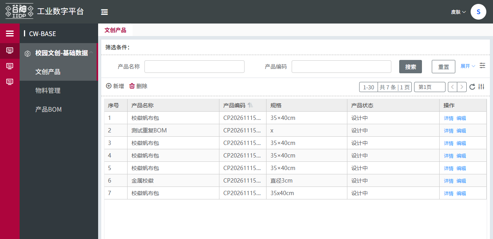
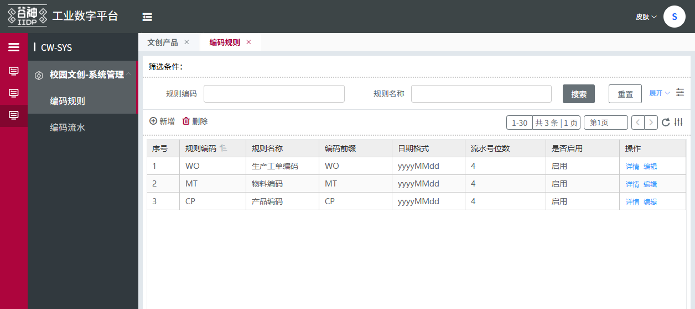

# 校园文创产品生产管理系统

> 《中级软件设计实作》课程项目 · 课题一 MES 管理系统 · 基于赛意 IIDP 模型驱动低代码平台的三个业务 APP

一个人、两周、从零到跑通：三个 Maven APP 模块、六张业务表、九个自定义服务、三张真实运行截图、12 条接口级测试用例全部通过，外加 55 页开发文档与 14 页汇报 PPT。



## 这是什么

学校文创工作室用 Excel 加微信群排产：产品编码靠人编、BOM 靠记忆、工单靠聊天记录。这个项目把"MES 的产品—BOM—物料—工单"这条主线搬进校园文创场景，用 IIDP 平台把它做成三个可独立部署的 APP。

| | |
| --- | --- |
| 业务场景 | 校徽帆布包、金属校徽、校园明信片、纪念马克杯等文创产品的打样与批量制作 |
| 系统边界 | 只管"东西怎么做出来"：主数据、BOM、编码、工单。不含商城、支付、物流、评价、采购、库存台账 |
| 角色 | 文创设计员、生产主管、仓库管理员、系统管理员 |
| 规模 | 3 个 APP、6 个模型、9 个自定义服务、11 个视图、9 个菜单 |

## 界面

表单页与 BOM 标签页——主子表在同一页维护，标签题上直接带明细条数：


编码规则页——三条规则（WO/MT/CP）同表维护，改完立即对后续取号生效：



## 课题九条要求怎么落的

| 课题要求 | 本项目实现 |
| --- | --- |
| 产品管理（名称、规格） | `cw_product` + 产品列表/表单视图 |
| 物料管理（编码唯一） | `cw_material`，编码由编码服务生成并加唯一约束 |
| 产品 BOM 标签页 + 数量 | 产品表单内 `产品BOM` 标签页，`cw_product_bom.amount` 存用量 |
| BOM 添加、删除 | 子表内增删行，随主表一次保存 |
| 编码规则增删改查 | `cw_code_rule` + 编码规则页面（前缀、日期格式、流水位数、分隔符、启用） |
| 按规则生成编码 | `codeRuleService.generate`，四段式 `CP20261115-0118` |
| 业务模型使用该服务 | 产品、物料、工单三类编码统一走同一套取号 |
| 身边的例子 | 校园文创工作室（本校真实场景） |
| 按模块拆分 APP | `cw-base` / `cw-prod` / `cw-sys` 三个 jar |

## 架构


- **cw-base**：产品、物料、产品 BOM（主数据）
- **cw-prod**：生产工单（跨 APP 用 `@ManyToOne(targetModel = "product")` 弱引用产品，不直接 import 对方类）
- **cw-sys**：编码规则、编码流水、编码生成服务

三个 APP 独立打包，但跑在同一个引擎进程里——两周工期不引入注册中心与网关，边界用包和 jar 表达。

## 技术栈

| 层 | 选型 |
| --- | --- |
| 后端 | Java 8、Spring Boot 2.7.13（引擎底座）、IIDP 引擎 v3.0.1-HOTFIX.002、SDK v3.0.1-UAT.003 |
| 构建 | Maven 3.9.1（离线构建，本地仓库 `D:\maven\repository`） |
| 数据库 | MySQL 8（库 `iidp_demo_v3`，六张业务表由模型注解自动建） |
| 缓存 | Redis（db5） |
| 前端 | 平台预编译 dist + nginx（30666），页面由视图 JSON 动态渲染，前端零代码 |
| 对象存储 | MinIO（19000，平台附件用） |
| 文档 | python-docx 生成 docx、python-pptx 生成 PPT、matplotlib 画图 |

## 目录结构

```
.
├── README.md
├── 校园文创产品生产管理系统-项目开发文档.docx / .pdf     # 55 页，10 章
├── 校园文创产品生产管理系统-项目汇报.pptx                # 14 页
├── source/                                            # 三个 APP 模块源码
│   ├── sie-snest-cw-base/    product / material / product_bom
│   ├── sie-snest-cw-prod/    work_order
│   └── sie-snest-cw-sys/     code_rule / code_seq + 编码服务
└── docs/
    ├── md/ch01.md … ch07.md    # 文档源（1–10 章）
    ├── figs/                   # 15 张图（用例、架构、ER、类图、时序、状态、截图）
    ├── build.py                # markdown → docx
    ├── figs.py                 # 全部插图的生成脚本
    └── make_ppt.py             # 汇报 PPT 生成脚本
```

## 快速开始

前提：JDK 8、Maven、MySQL 8、Redis、IIDP 引擎包（课程提供）、nginx 与平台前端 dist（课程提供）。

```bash
# 1. 构建三个 APP（产物自动复制到 apps/modules）
mvn -s settings.xml -o -DskipTests package

# 2. 启四个进程：Redis(6379) → 授权服务 grant-dev(8080) → 引擎(8061) → nginx(30666)
java -jar sie-iidp-demo-start/target/sie-iidp-demo-start-1.0-SNAPSHOT.jar

# 3. 浏览器打开 http://localhost:30666/iidp/
```

账号：`admin_000001 / Admin_000001`。

配置只改三处：`dbcp.properties` 的数据库连接、`application-dev.properties` 的 `image.minimal.requiredApps`（追加 cw 三个 APP）、`apps/apps.json` 的 SDK 列表。

> **注意**：改 `application-dev.properties` 后必须重新打包才生效；重启前先停 java 进程，否则 `apps/modules` 下的 jar 被占用。

### 一个必须手动补的授权

自研 APP 的菜单要显示，除了 `tenant_meta_mapping` 里的菜单映射，还需要**应用级授权**（这一步平台 UI 会写，手工部署容易漏）：

```sql
INSERT INTO rbac_role_auth (id, version, app_all, app_tag, role, app_name, tenant_id, create_user, create_date)
SELECT REPLACE(UUID(),'-',''), 0, '1', 'master', 'rbac_role_admin', 'cw-base', 'rbac_tenant_root', 'admin', NOW();
-- 同理补 cw-prod、cw-sys，以及目标角色的行
```

缺这几行时，`ui_menu.loadMenu` 返回空数组，页面白屏——这是本项目花时间最多的坑，排查全过程写在文档 6.9 节。

## 关键实现

**并发安全的编码服务**。参考程序的 `CodeGenerator` 用静态计数器，进程重启即归零、多实例必然重号。改成"规则表 + 流水表 + 行锁 + 条件自增 + 唯一索引"：

```sql
SELECT curr_value FROM cw_code_seq WHERE rule_code = ? AND date_seg = ? FOR UPDATE;
UPDATE cw_code_seq SET curr_value = curr_value + 1 WHERE id = ? AND curr_value = ?;
```

20 线程并发取号 20/20 唯一、号码连续，`preview` 只读不占号。

**跨 APP 引用**。两个 APP 由不同类加载器加载，直接 `import` 对方模型运行期会 `NoClassDefFoundError`，改用 `@ManyToOne(targetModel = "product")` 让引擎按模型名在全局元数据里解析。

**BOM 主子表**。`@OneToMany` + 视图 JSON 的 `tabs` 配置，产品表单里直接出子表标签页，增删行随主表一次提交；用量 > 0、同产品同物料唯一在服务层校验。

## 踩过的坑（都写进文档了）

| 坑 | 真相 |
| --- | --- |
| 引擎启动 NPE | `apps/modules` 混入重复版本的 UAT jar 与示例 jar，解析出的 APP 列表含 null 元素 |
| 菜单空白 | 缺 `rbac_role_auth` 应用级授权，不是菜单表的问题 |
| 服务调不到 | SDK 只扫描 `@Model` 类上的 `@MethodService`，独立 `@Service` 类不生效 |
| 查询恒空 | `search(filter, properties, ...)` 的 `properties` 传 null 时引擎拼不出 SELECT 列 |
| 平台 `create` 服务 500 | 该版本 `BussModelDataAccess.create` 取不到记录列表，改用自研服务 |

## 文档

| 文件 | 说明 |
| --- | --- |
| `校园文创产品生产管理系统-项目开发文档.pdf` | 55 页 10 章：需求、可行性、概要设计、详细设计、实现、分工、学习与中期检查、过程管理、总结 |
| `校园文创产品生产管理系统-项目汇报.pptx` | 14 页答辩用 |
| `docs/md/` | 文档 Markdown 源，改完跑 `python docs/build.py` 重新出稿 |

文档里的图全部由 `docs/figs.py` 用 matplotlib 生成（用例图、分层架构、功能结构、ER 图、类图、时序图、活动图、状态图），截图则是真实运行环境所拍。

## 已知限制

- 开发者中心的"模型管理/菜单管理"在本机库里不可用（`meta_model`、`meta_menu` 无数据），页面靠应用级授权走通，发布态流程未验证。
- 权限矩阵只验证了应用级授权这一层，逐格权限用例未做完。
- 工单表单底部按钮的可见性目前由权限控制，还没有按 `status` 配到视图 `action` 上。

## 致谢

赛意 IIDP 平台与课程提供的参考程序（`iidp-backend-demo`）提供了技术栈基线；本文档与代码里的业务设计均为原创。
